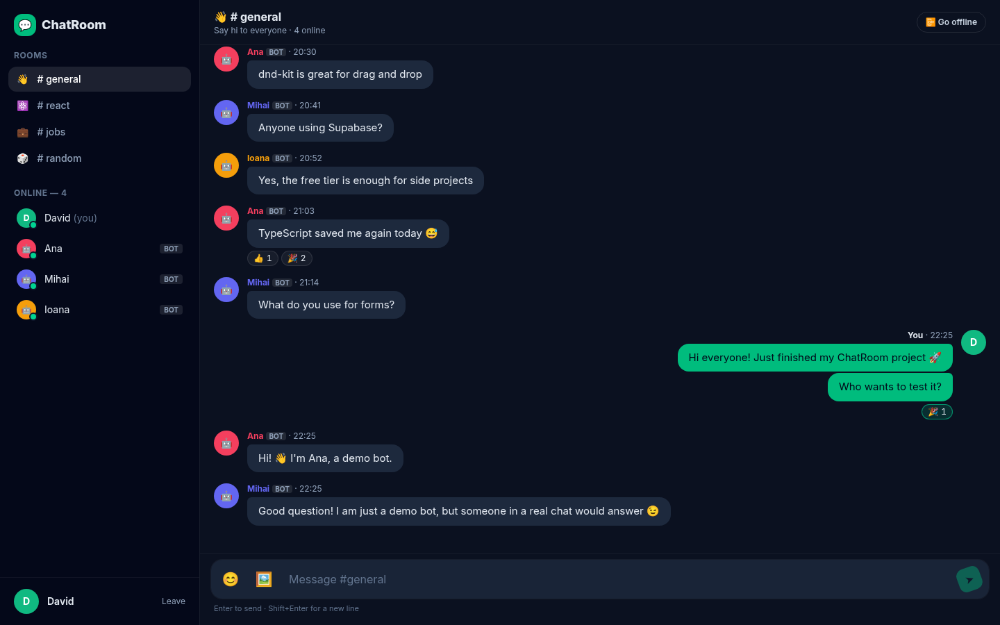
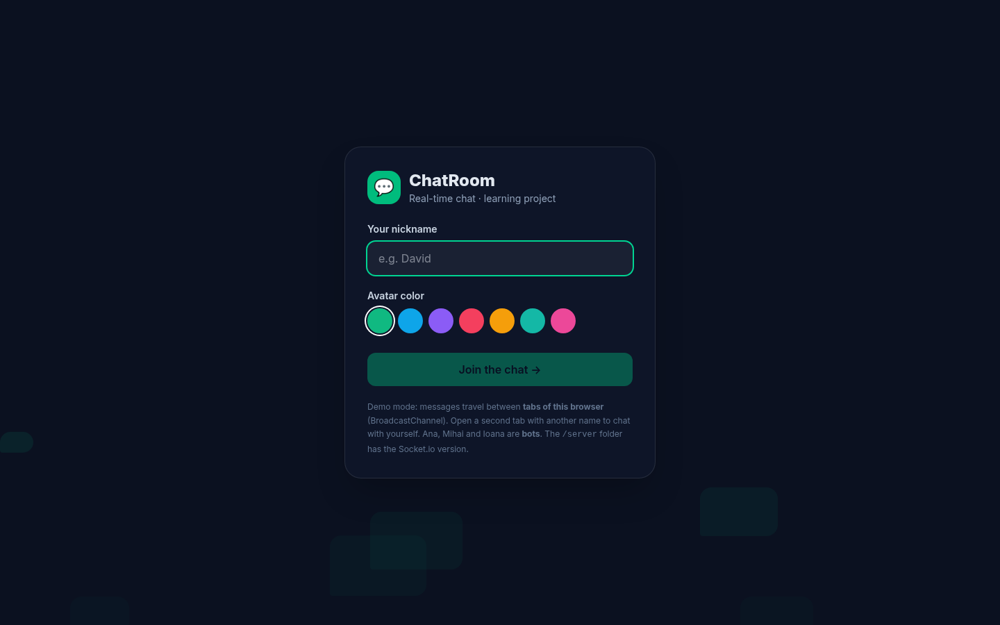
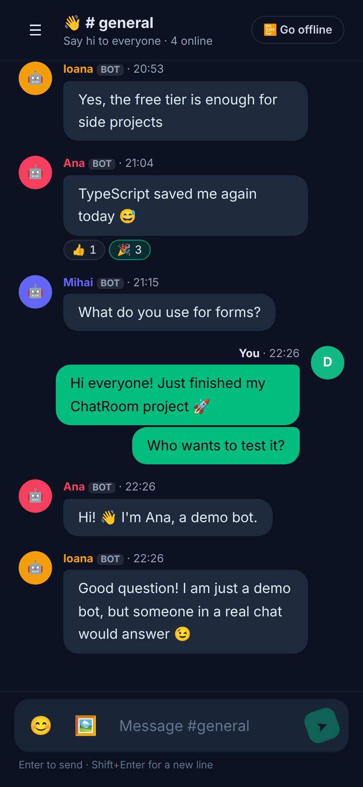

# ChatRoom — real-time chat

A real-time chat app built with **React 19**, **TypeScript**, **Zustand** and **Motion**, with a **Socket.io** server in [`/server`](server/README.md).
Learning project #9 from my portfolio plan.

**Live demo:** https://davidgeorgeconstantin-spec.github.io/chatroom/

> **How the live demo works:** GitHub Pages can't run a server, so the demo uses the browser's **BroadcastChannel** API: messages, typing and presence travel live between **tabs of the same browser**. Open two tabs with two nicknames to try it. Ana, Mihai and Ioana are **bots** (clearly labelled) that reply sometimes. Build with `VITE_SOCKET_URL` set and the same UI talks to the real Socket.io server instead.



## Features
- Nickname + avatar color (each browser tab can be a different person)
- 4 rooms with unread badges
- Instant messages, grouped by author and day, with auto-scroll that respects reading position and a "new messages" button
- "X is typing…" (throttled + debounced) and an online users list (heartbeat-based presence)
- Emoji reactions (toggle) and an emoji picker
- Image sending — resized in the browser with `<canvas>` before sending, shared-element lightbox
- Load older messages (cursor pagination + infinite scroll upwards, scroll position kept)
- Reconnection handling: "Go offline" button to simulate a lost connection; messages are queued and flushed on reconnect
- Animations: floating bubbles on the join screen, spring message entrance, `layoutId` active room and image lightbox, pop-in reaction picker with staggered emojis, rolling reaction counters, typing dots, mobile drawer, connection banner. `prefers-reduced-motion` respected.

## Architecture
The UI depends on a small `ChatTransport` interface (`src/transport/types.ts`), with two implementations:

| Transport | Used when | How |
|---|---|---|
| `BroadcastTransport` | default (GitHub Pages) | BroadcastChannel + localStorage history + simulated bots |
| `SocketTransport` | `VITE_SOCKET_URL` is set | socket.io-client → `/server` |

## Server (`/server`)
Express + Socket.io: handshake validation (Zod), rooms, presence with multiple tabs per user, typing, reactions, history with acknowledgement callbacks, per-socket rate limiting, server-side identity and timestamps. 5 integration tests with real sockets (Vitest).

## Stack
React 19 · TypeScript strict · Vite 7 · Tailwind CSS 4 · Zustand 5 · React Router 7 · Motion 12 · Socket.io 4 · Express 5 · Zod · Vitest · GitHub Actions

## Structure
```
src/
├─ components/layout/     # ChatLayout (sidebar + mobile drawer)
├─ components/ui/         # Avatar
├─ features/
│  ├─ auth/               # JoinScreen, sessionStore (sessionStorage = one user per tab)
│  ├─ chat/               # chatStore, TransportContext, RoomView, MessageList, MessageItem,
│  │                      # ReactionBar, Composer, TypingIndicator, ConnectionBanner, ImageLightbox
│  └─ rooms/              # Sidebar (rooms, unread, online users)
├─ hooks/                 # useRoom (history + pagination), useTypingEmitter
├─ lib/                   # rooms, reactions, image resize, time, id
├─ transport/             # ChatTransport interface, broadcast + socket implementations, bots, seed
└─ types/
server/                   # Socket.io server + tests
```

## Run locally
```bash
npm install && npm run dev                       # demo mode, http://localhost:5173
cd server && npm install && npm run dev           # Socket.io on http://localhost:4200
VITE_SOCKET_URL=http://localhost:4200 npm run dev # frontend using the real server
```

## Deploy
`.github/workflows/deploy.yml` → GitHub Pages (Settings → Pages → Source: **GitHub Actions**). The server can be deployed for free on Render (free web service; it sleeps when idle).

## Screenshots
| Join | Mobile |
|---|---|
|  |  |
